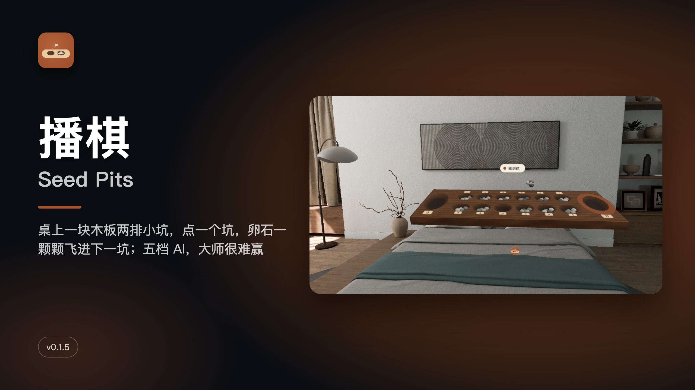
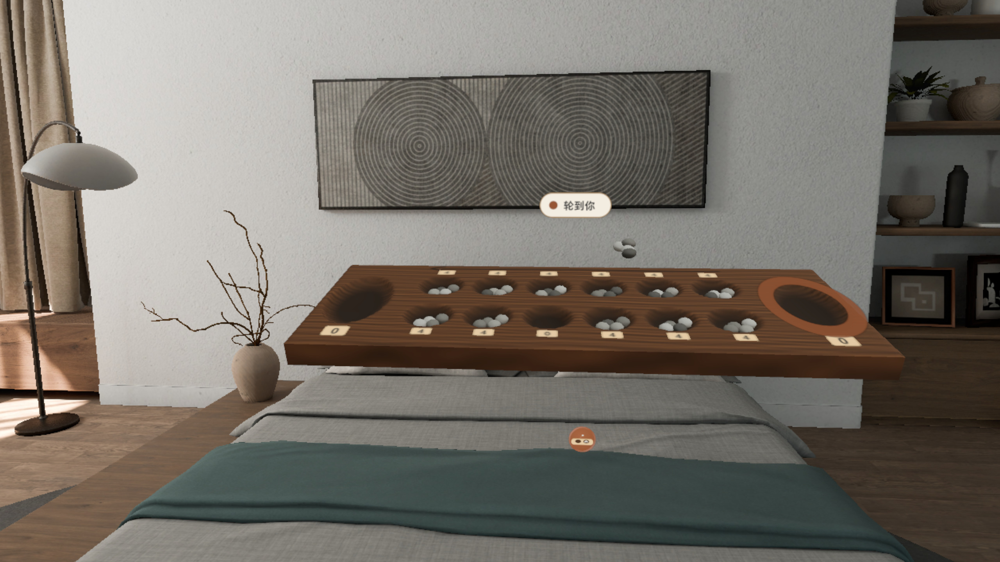
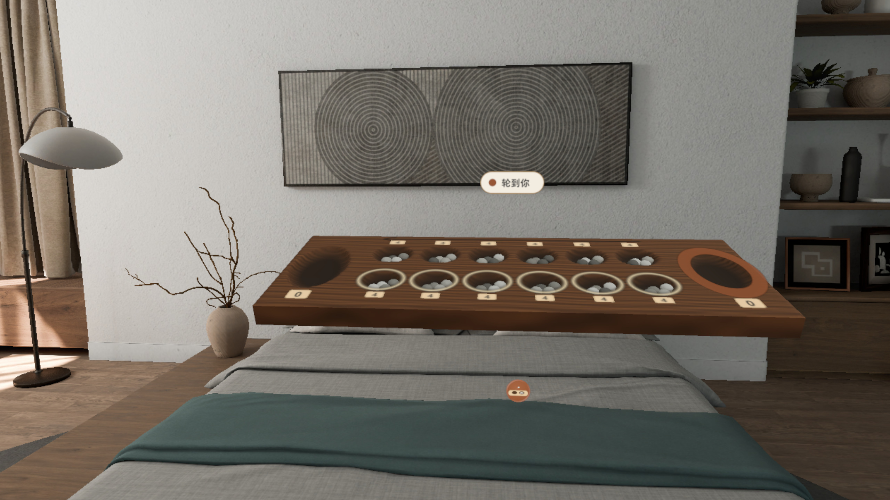
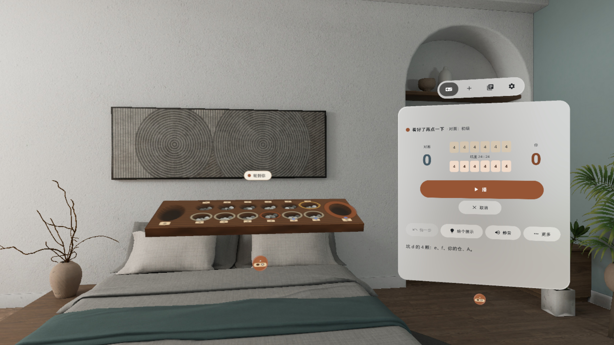
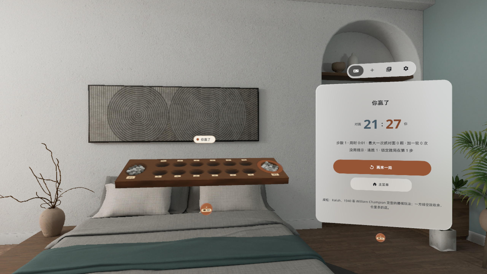
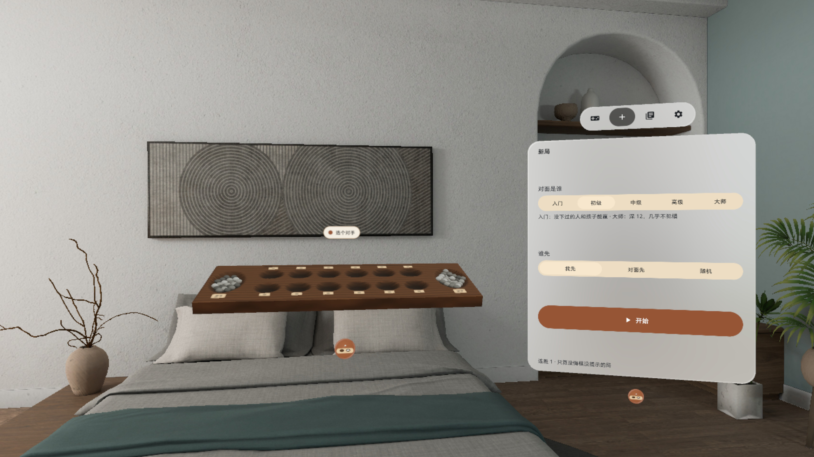
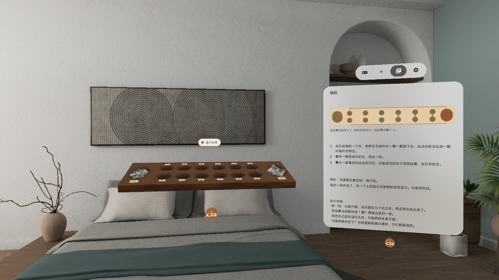

# 播棋 Seed Pits



[中文](#中文) · [English](#english)

---

## 中文

**桌上一块木板两排小坑，点一个坑，卵石一颗颗飞进下一坑；五档 AI，大师很难赢。**

PICO 空间应用（PICO OS 6 · Spatial SDK BOM 6.1.9 · Shared Space 体积窗口）。一块 66 cm 长的木板摆在你面前：两排各六个小坑、两头各一个大仓、48 颗河卵石。规则是流传上千年的播棋（Kalah）：点一个自己的坑，那把石子沿逆时针一颗一颗撒下去；最后一颗落进自己的仓就再来一轮，落进自己这边的空坑就把对面那坑整把抓走。

### 能做什么

- **先看再走**：点一个坑先预览——路径上的坑亮起、终点一圈琥珀色，控制窗写出这一步的结果；再点一次或按 [播] 才走
- **看得见的播种**：一把石子被抓起，沿弧线逐颗落坑，落点减速、轻弹、滚动；抓对面、收余也是逐颗错开的动画
- **真实的声音**：落坑、落仓、抓起、扫仓都是 CC0 实物录音，每次随机变体、音高略有起伏，连续落子自动降音
- **五档 AI**：入门 / 初级 / 中级 / 高级 / 大师，本机 α-β 搜索；悔一步、重做、提示、认输、重开
- **系统原生窗口**：棋盘在系统立体窗口里，用下方系统把手拖动、等比缩放；控制窗（对局 / 新局 / 规则 / 设置）在棋盘右侧
- 倾角 0° / 15°、坑边数字牌开关、减少动态、音量三档；每回合自动存档；眼手捏合 / 手柄射线都能点坑；中英双语；本机运行，不联网、不要账号

### 截图

> v0.1.5 截图来自 PICO 模拟器（画质高清 2560，中文界面），由调试广播驱动，**非真实手势录像**。演示视频 `video-01.mp4` 在 Release 资产里（同样非真实手势录像，无声）。

| | |
|---|---|
|  播种瞬间：一把卵石刚被抓起，要沿弧线撒进后面的坑 |  开局：两排六坑各 4 颗，两头大仓，坑边数字牌 |
|  预览：路径亮起、终点琥珀环，按 [播] 才走 |  结果：你赢了 27 : 21 |
|  新局：五档 AI 和先后手 |  规则：一条示意图 + 三句话 |

### 安装

[Release v0.1.5](https://github.com/kejing-dev/SeedPits/releases/tag/v0.1.5) 里的 `SeedPits-v0.1.5.apk` 是 `assembleRelease` 出的未签名包（给应用商店上架用，`adb install` 会拒绝）。自己装请从源码构建 debug 包，头显开启开发者模式并用 USB 连上电脑：

```bash
./gradlew assembleDebug
adb install -r app/build/outputs/apk/debug/app-debug.apk
pico-cli app launch io.embodit.seedpits
```

需要 PICO OS 6（Android 15，minSdk 35）。不需要额外权限。

### 已知问题

1. v0.1.5 只改了动画和声音；界面和规则的模拟器 QA 以 v0.1.4 的第 4 轮为准（已过），v0.1.5 由用户在头显上试玩后放行。
2. 落坑声用的是筹码落在毡面上的录音（没有现成的卵石落木坑录音）。
3. 新局页、规则页不能滚动，文案再加长时上下可能被裁。
4. 对局页中部主按钮位置留空，中间有一条空带。
5. 默认距离下棋盘上的数字牌偏小（控制窗上有同样的数字）。
6. 播种动画期间最长约 2.6 秒不接受输入。
7. 谜题、每日一题、双人同机、回放在下个版本。

### 版本历史

- **v0.1.5**：真机试玩反馈后，播种 / 抓起 / 抓对面 / 收余改成物理弧线 + 落点减速 + 弹滚、逐颗错开；所有实物声换成 Kenney CC0 录音
- **v0.1.4**：新局页、规则页整窗排版，不再顶对齐留大片空白；补存档前置的新局确认单测
- **v0.1.3**：对局页和结果卡居中，仓数字放大到 56 sp
- **v0.1.2**：有进度时开新局先确认；「重开控制窗」回到棋盘旁边；64 dp 主按钮
- **v0.1.1**：音量加大、控制窗 640 dp 不再被切、退出关掉所有窗口、体积等比缩放
- **v0.1.0**：首个版本，Kalah 木板体积 + 控制窗、五档 AI、播种动画

### 许可与素材

- 字体：Noto Sans（Apache-2.0，见 `third_party/`）
- 音效：Kenney（kenney.nl）casino-audio / impact-sounds / interface-sounds，CC0 1.0
- 木板和卵石模型由 `tools/build_board.py` 纯 Python 生成
- 本仓库公开；用 Claude Code 在「黑灯工厂」产线上研发（Claude Opus 5.5 研发 / QA / 发布，Claude Fable 5.1 调研 / 设计）
- 开发结构、调试命令见 [AGENTS.md](AGENTS.md)

---

## English

**A wooden board with two rows of pits on your table: tap a pit and the pebbles fly one by one into the next pits. Five AI levels — Master is hard to beat.**

A PICO spatial app (PICO OS 6 · Spatial SDK BOM 6.1.9 · Shared Space volume). A 66 cm board sits in front of you: two rows of six pits, a store at each end, 48 river pebbles. The rules are the classic Kalah: tap one of your pits and its pebbles are sown counterclockwise one by one; if the last one lands in your store you go again, if it lands in an empty pit on your side you capture the opposite pit.

### Features

- **Look before you move**: the first tap previews the move — the path lights up, the landing pit gets an amber ring, the control window says what will happen; tap again or press [Sow] to play
- **Sowing you can see**: the handful lifts and arcs into each pit with slow-in landings, a small hop and roll; captures and the final sweep are staggered stone by stone
- **Real sounds**: pit drops, store drops, grabs and sweeps are CC0 recordings with random variants and slight pitch changes; overlapping sounds duck
- **Five AI levels**: Easy / Casual / Smart / Strong / Master, local alpha-beta search; undo, redo, hint, resign, restart
- **Native system window**: the board lives in a system volume — move and resize it with the system handle; the control window (Play / New game / Rules / Settings) sits to its right
- Tilt 0° / 15°, pit numbers on/off, reduced motion, three volume levels; autosave every turn; eye-hand pinch and controller ray both work; Chinese and English; fully offline, no account

### Screenshots

> v0.1.5 PICO emulator screenshots (high-definition 2560, Chinese UI), driven by debug broadcasts — **not a recording of real hand input**. The demo video `video-01.mp4` is a Release asset (also not real hand input, no sound).

| | |
|---|---|
|  Sowing: a handful just lifted, about to arc into the next pits |  Start: 4 pebbles in each of 12 pits, stores at both ends |
|  Preview: path lit, amber ring on the landing pit, press [Sow] to play |  Result: you win 27 : 21 |
|  New game: five AI levels and who starts |  Rules: one diagram, three sentences |

### Install

`SeedPits-v0.1.5.apk` in [Release v0.1.5](https://github.com/kejing-dev/SeedPits/releases/tag/v0.1.5) is an unsigned `assembleRelease` build (for store submission; `adb install` rejects it). To install it yourself, build the debug APK from source, enable developer mode on the headset and connect it over USB:

```bash
./gradlew assembleDebug
adb install -r app/build/outputs/apk/debug/app-debug.apk
pico-cli app launch io.embodit.seedpits
```

Requires PICO OS 6 (Android 15, minSdk 35). No extra permissions.

### Known issues

1. v0.1.5 only changes animation and sound; emulator QA of the UI and rules is round 4 on v0.1.4 (passed); v0.1.5 was approved after the user played it on a headset.
2. The pit-drop sound is a clay chip landing on felt (no ready-made pebble-on-wood recording).
3. The New and Rules pages do not scroll; longer copy could be clipped.
4. The main-action slot in the middle of the Play page is left empty.
5. Pit number tiles on the board are small at the default distance (the control window shows the same numbers).
6. Input is locked for up to about 2.6 s while stones are sown.
7. Puzzles, daily puzzle, hot-seat and replay come in the next version.

### Version history

- **v0.1.5**: after headset play-testing, sowing / grabbing / captures / sweeps use physical arcs with slow-in landings, hops and rolls, staggered per stone; all physical sounds replaced by Kenney CC0 recordings
- **v0.1.4**: New and Rules pages fill the window; saved-game confirm tests
- **v0.1.3**: Play page and result card centred; 56 sp store counts
- **v0.1.2**: confirm before a new game when there is progress; "Reopen panel" returns it beside the board; 64 dp main actions
- **v0.1.1**: louder sound, 640 dp control window, exit closes every window, uniform volume scaling
- **v0.1.0**: first version — Kalah board volume + control window, five AI levels, sowing animation

### License and assets

- Font: Noto Sans (Apache-2.0, see `third_party/`)
- Sounds: Kenney (kenney.nl) casino-audio / impact-sounds / interface-sounds, CC0 1.0
- Board and pebble models generated in pure Python by `tools/build_board.py`
- Public repository; built with Claude Code on the "lights-out factory" pipeline (Claude Opus 5.5 build / QA / release, Claude Fable 5.1 research / design)
- Project structure and debug commands: [AGENTS.md](AGENTS.md)
